# SYNK — How to record a chart

A step-by-step guide to recording, correcting, reviewing, and saving a playable chart.

**Updated:** 16 October 2026. **Screenshots:** the current SYNK interface, using Eclipse and prepared demonstration notes. Screenshots were captured from the running game with separate documentation-only save data; your charts were not changed.

## Contents

1. [Your first recording in ten steps](#your-first-recording-in-ten-steps)
2. [Open a song in Chart Studio](#1-open-a-song-in-chart-studio)
3. [Check the song timing](#2-check-the-song-timing)
4. [Choose where to record](#3-choose-where-to-record)
5. [Configure the recorder](#4-configure-the-recorder)
6. [Record notes on the highway](#5-record-notes-on-the-highway)
7. [Correct notes without leaving the recorder](#6-correct-notes-without-leaving-the-recorder)
8. [Use the recording pause menu](#7-use-the-recording-pause-menu)
9. [Review, replay, and keep a take](#8-review-replay-and-keep-a-take)
10. [Repeat and combine takes](#9-repeat-and-combine-takes)
11. [Save, validate, and test the chart](#10-save-validate-and-test-the-chart)
12. [Record in separate passes](#record-in-separate-passes)
13. [Customize note visibility](#customize-note-visibility)
14. [Settings ownership and saving](#settings-ownership-and-saving)
15. [Troubleshooting](#troubleshooting)
16. [Control reference and glossary](#control-reference-and-glossary)

## Your first recording in ten steps

For a first attempt, use **Layer**, **All Types**, **Free timing**, and **Loop Takes OFF**. Start with a short phrase and record taps before adding complicated gestures.

1. From the lobby, choose **CREATE CHARTS**.
2. Open a song in the **CHART LIBRARY**, or choose **IMPORT AUDIO**.
3. In Chart Studio, open **CHART TOOLS → THIS CHART → Timing**. Check the BPM and first-beat offset.
4. Move the playhead to the start of the phrase. For a bounded section, select a range with **RANGE**.
5. Press **SETUP** beside **RECORD**. Choose Layer and All Types. Enable Punch In if you selected a section. Optionally choose one bar of pre-roll.
6. Press **DONE**, then **● RECORD**. Wait for the countdown and any audible lead-in.
7. Tap near the glowing judgment bar in time with the music. Each gesture creates a note in its lane.
8. Press **■ STOP** to open **TAKE REVIEW**. Replay the phrase and inspect the highlighted notes.
9. Choose **KEEP TAKE** when satisfied, or **RETRY SECTION** to record another attempt.
10. Press **SAVE** in Chart Studio. Use **TEST FROM HERE** to check how the chart plays.

**The important saving distinction:** Keep Take accepts notes into your draft. **SAVE** updates the chart used for published playback.

## 1. Open a song in Chart Studio

### Choose the charting mode

On the lobby, press **CREATE CHARTS**.

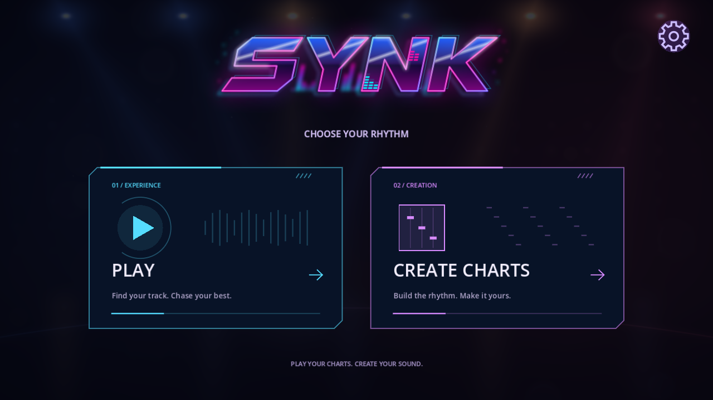

*Figure 1. CREATE CHARTS opens the chart library.*

### Open an existing song or import audio

The Chart Library lists available songs. Tap a song card to edit its chart. To start with another audio file, use **IMPORT AUDIO +** at the top or the **IMPORT AUDIO** card. Supported audio formats are MP3, WAV, and OGG.

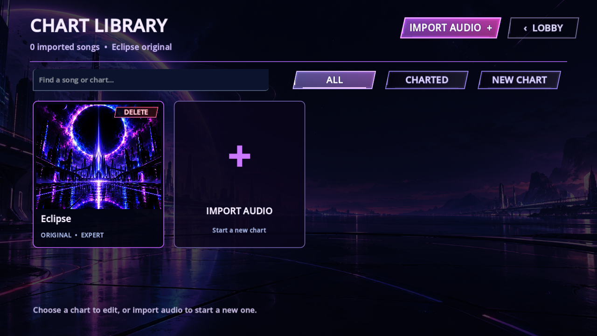

*Figure 2. Choose a song card or import your source audio.*

### Find the recording controls

In Chart Studio:

- **● RECORD** starts recording using the current setup.
- **SETUP** opens recording options.
- **CHART TOOLS** contains chart timing, versions, validation, and the Recording section.
- **SONG DETAILS** contains shared song information and audio import.
- **SAVE** saves the chart.
- The vertical timeline shows time increasing downward, with lanes across the width.

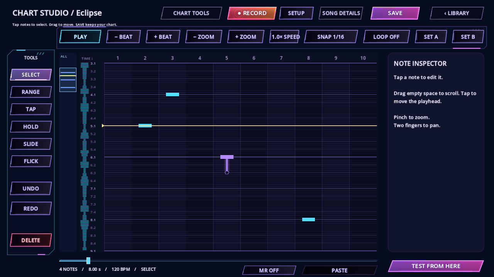

*Figure 3. RECORD and SETUP are beside each other in the top toolbar.*

You can open **SONG DETAILS** to edit the song title and album, import audio, or reach **CHART TIMING**. These song details apply across the song's chart versions.

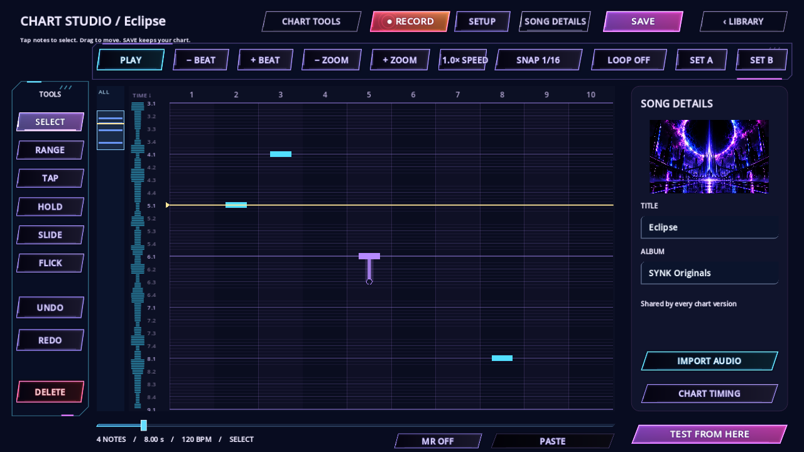

*Figure 4. Song Details includes IMPORT AUDIO and the CHART TIMING shortcut.*

## 2. Check the song timing

Open **CHART TOOLS → THIS CHART → Timing**, or use **SONG DETAILS → CHART TIMING**.

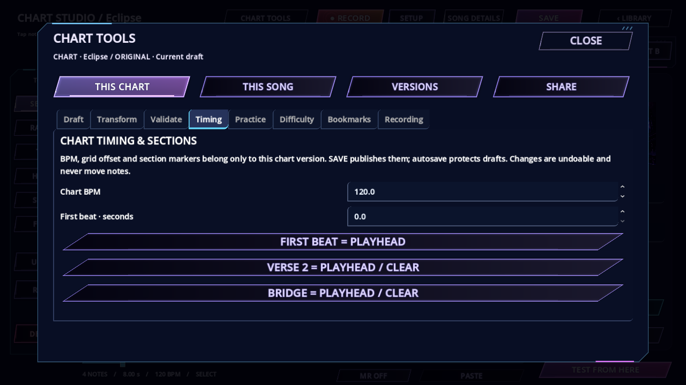

*Figure 5. BPM and first-beat offset define this chart version's beat grid.*

Set these before relying on quantization or the rhythm guide:

| Setting | What it controls | How to use it |
| --- | --- | --- |
| Chart BPM | The musical beat spacing | Enter the song's tempo. Listen against the guide to check the grid. |
| First beat — seconds | Where the beat grid begins | Enter the first beat's song time, or position the playhead and press **FIRST BEAT ← PLAYHEAD**. |
| Verse 2 / Bridge | Named song-section markers for this chart version | Set them from the playhead when useful. They do not automatically set the recorder's punch range. |

For example, at **120 BPM**, a beat lasts **0.5 seconds** and a four-beat bar lasts **2 seconds**. If the first beat is at 0.2 seconds, the grid follows that offset.

**Check both early and late in the song.** If the guide gradually drifts, recheck the BPM. If it stays consistently displaced, recheck the first-beat offset. Device audio calibration is a separate global setting under **Settings → Audio & Sync**.

Changing BPM or the grid offset does not automatically move previously placed notes. It changes the grid used for snapping and guide playback.

## 3. Choose where to record

### Record from the playhead

With **Punch In OFF**, recording begins at the current editor playhead and continues toward the song end. Move the playhead using the timeline or bottom seek slider before pressing RECORD.

### Record only a selected section

1. Choose **RANGE** on the left tool rail.
2. Drag along the vertical timeline to select a time interval.
3. Check the start and end times in the right-hand **RANGE SELECTION** panel.
4. Open **SETUP** and turn **PUNCH IN · USE SELECTED RANGE / A–B** on.

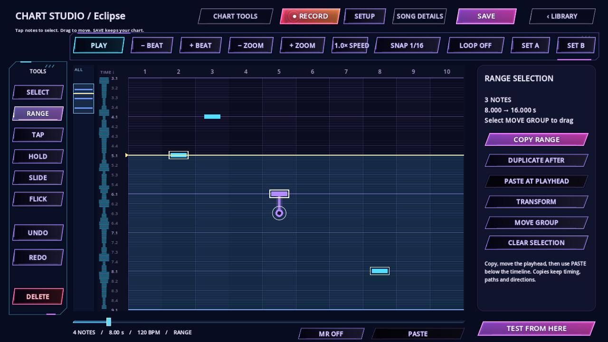

*Figure 6. The example selects 8.00–16.00 seconds. Punch-in restricts new notes to that interval.*

Alternatively, position the playhead and use **SET A**, then move to the desired end and use **SET B**. With Punch In enabled, the recorder uses an active range selection first; otherwise it uses A–B.

**Before recording, confirm which bounds you intend to use.** An active range takes precedence over A–B. Editor **LOOP ON/OFF** controls editor audition; **LOOP TAKES** in Recording Setup controls repeated recording attempts.

## 4. Configure the recorder

Press **SETUP** beside RECORD. You can also open **CHART TOOLS → THIS CHART → Recording → RECORDING SETUP**. During recording, **TAKE SETUP** pauses the recorder and opens the same options.

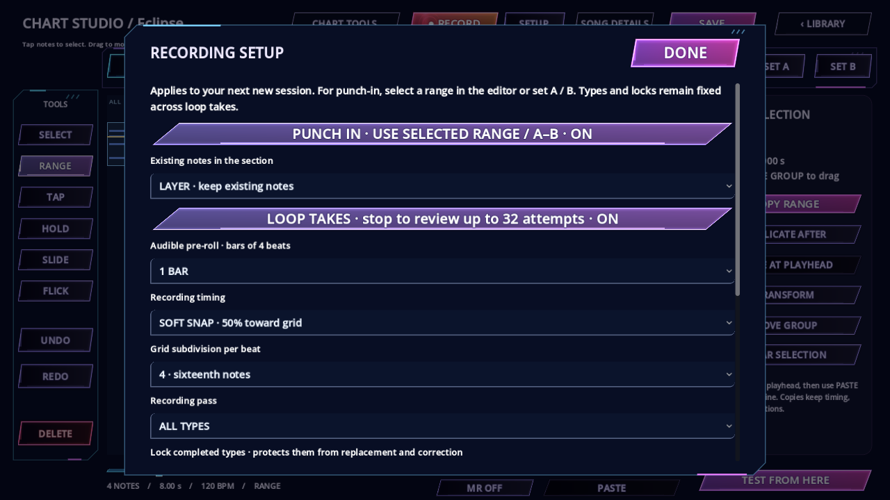

*Figure 7. The upper part of Recording Setup configures the recording boundaries and timing.*

### Layer or Replace

| Mode | Result | Suitable use |
| --- | --- | --- |
| **LAYER** | Keeps existing notes and adds your new take | Building a chart in passes or adding missing details |
| **REPLACE** | Replaces eligible existing notes whose starts lie inside the recording region | Re-recording a phrase that needs substantial correction |

Replacement respects the selected recording pass and locked types. Notes outside the region remain intact. An earlier sustain whose start lies before the region is kept, even if its tail crosses the punch start. An empty take leaves the existing chart unchanged.

### Audible pre-roll

Choose **OFF** or **1–4 bars** of lead-in. In this recorder, a bar means **four beats**. The music plays before the punch start so you can hear the rhythm before adding notes.

- The normal countdown happens first.
- Audible pre-roll follows the countdown.
- Notes cannot be captured before the punch start.
- Near the beginning of a song, lead-in is limited by the audio available before that point.

### Recording quantization

| Timing mode | Effect on captured timing |
| --- | --- |
| **FREE** | Preserves your recorded timing |
| **SOFT SNAP** | Moves note timing halfway toward the nearest recording-grid point |
| **STRICT SNAP** | Aligns note timing to the recording grid |

Choose the recording grid separately:

| Subdivisions per beat | Musical spacing |
| --- | --- |
| 1 | Quarter notes |
| 2 | Eighth notes |
| 4 | Sixteenth notes |
| 8 | Thirty-second notes |

Quantization is applied when the take is prepared for review. It uses this chart's BPM and first-beat offset; sustained-note lengths, slide paths, and checkpoint timing follow the duration adjustment.

**The recorder grid and the editor SNAP button are separate controls.** Changing editor SNAP does not change the recording quantization mode.

### Recording passes, locks, and rhythm guide

Scroll down to find the remaining options.

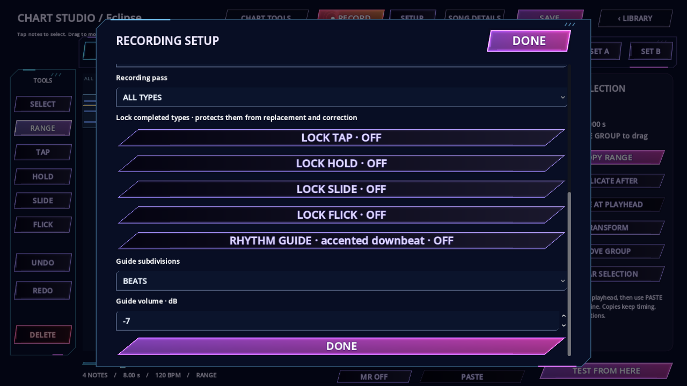

*Figure 8. Type locks protect completed work; the guide has its own subdivision and volume.*

Use **ALL TYPES** for general recording, or choose **TAPS ONLY**, **HOLDS ONLY**, **SLIDES ONLY**, or **FLICKS ONLY** for a focused pass. Turn on a type's **LOCK** when it should be protected from replacement and in-recorder correction.

The **RHYTHM GUIDE** provides a stronger downbeat, with **BEATS**, **EIGHTHS**, or **SIXTEENTHS**. Its volume is independent of the music: 0 dB is louder than −30 dB.

Press the fixed **DONE** button at the top when ready.

**Setup changes apply to the next new recording session.** The current session's type locks, pass, and timing configuration remain fixed across its loop attempts. To use a new configuration, finish the current session, change setup, then start a new recording with RECORD.

## 5. Record notes on the highway

### Wait for the countdown and lead-in

Press **● RECORD**. The game switches to the highway and displays the countdown.

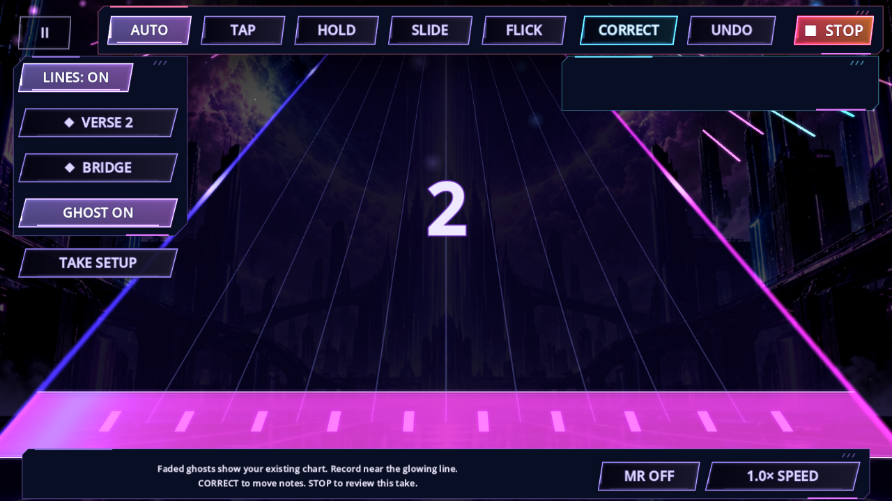

*Figure 9. Wait until the countdown finishes before entering notes.*

With pre-roll enabled, the music then plays the available lead-in. **PRE-ROLL · LISTEN** and **REC AT … s** indicate that the capture region has not started yet.

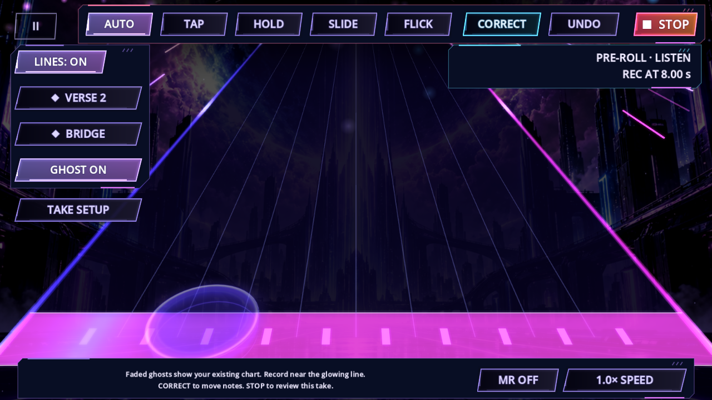

*Figure 10. Listen to the lead-in. Inputs before the punch start do not create notes.*

### Make gestures near the judgment bar

Record in the lower highway area, near the glowing judgment bar. Choose a lane by the horizontal position of your finger. For chords, use multiple fingers together.

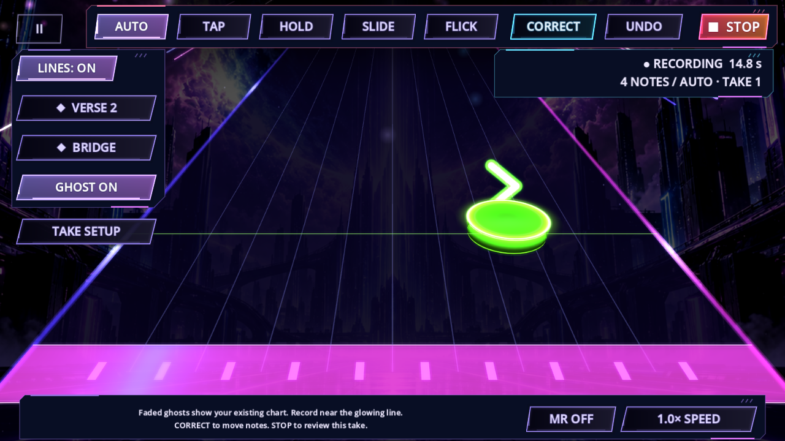

*Figure 11. Note tools run across the top. STOP opens take review; speed and MR are at the bottom.*

| Tool | Gesture | Result |
| --- | --- | --- |
| **AUTO** | Brief tap and release | Tap note |
| **AUTO** | Keep touching roughly the same lane | Hold note |
| **AUTO** | Keep touching while moving across lanes | Slide note |
| **TAP** | Tap and release | Tap note |
| **HOLD** | Touch, sustain, then release | Hold with the captured duration |
| **SLIDE** | Touch, trace a lane path, then release | Slide following the captured path |
| **FLICK** | Make a clear upward, leftward, or rightward swipe | Directed flick note |

AUTO treats gestures shorter than about **0.22 seconds** as taps. Longer gestures become holds or slides according to lateral movement. AUTO does not infer flicks; select FLICK or a Flicks Only pass for those. Downward flicks are not supported by the current recorder.

Notes are finalized when you release your finger. Stopping a take also finalizes active gestures at the recording boundary. Very short sustains may be discarded or flagged for review.

### Helpful recording controls

- **GHOST ON/OFF:** shows or hides faded existing-chart notes approaching the judgment bar. Turning ghosts off does not delete those notes.
- **LINES ON/OFF:** toggles alignment guides.
- **UNDO:** removes the latest completed note in the current capture.
- **Speed:** cycles through 1×, 0.75×, 0.5×, 0.25×, 1.25×, and 1.5×. Captured timing remains in the source song's chart time.
- **MR OFF/ON:** requests the vocal-reduced listening mode. Use it when vocals make the underlying rhythm harder to hear; the reduction depends on the audio source.
- **Verse 2 / Bridge:** marks those chart sections at the current song time.
- **■ STOP:** finishes the take and opens review.

A useful first attempt is **0.75× speed**, **TAP**, and a short section. Add sustained notes and flicks after the basic rhythm feels right.

## 6. Correct notes without leaving the recorder

Press **CORRECT** at the top. The transport pauses and the highway becomes editable. The button changes to **RECORD**.

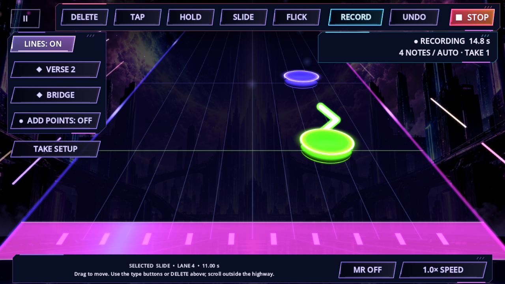

*Figure 12. Select a note, then move it or change its type without leaving the recorder.*

1. Tap a visible note to select it.
2. Drag horizontally to change its lane.
3. Drag along the highway to adjust its timing.
4. Scroll from beside the highway to reach another time while keeping the selection.
5. Use the type buttons to convert the selected note, or **DELETE** to remove it.
6. For a hold or slide, **ADD POINTS** enables checkpoint editing along its trail.
7. Press **RECORD** to resume recording from the correction position.

Locked types cannot be selected for correction. A focused pass also restricts the available conversion types.

**Correction can edit existing chart notes as well as notes from the current capture.** Edits to existing notes are document edits with their own undo history. **UNDO TAKE** rolls back the provisional recorded take; it does not promise to discard every earlier correction to existing notes.

When stopping, notes outside the configured punch region are excluded from the prepared take. Keep timing corrections inside the region if you want those captured notes retained.

## 7. Use the recording pause menu

Press **II** to pause.

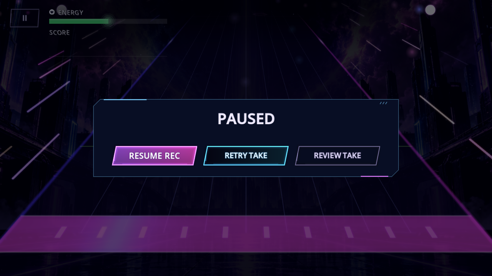

*Figure 13. Recording pause actions return to the recorder or its take review.*

| Button | Action |
| --- | --- |
| **RESUME REC** | Returns to recording with a resume countdown. If you paused during correction mode, the correction transport stays paused. |
| **RETRY TAKE** | Restarts recording from the current recording playback start, discarding the in-progress attempt. With punch-in, the selected section is reused. |
| **REVIEW TAKE** | Ends the current take and opens its review in Chart Studio. It does not send you to the lobby. |

For choosing between completed loop attempts, use **REVIEW TAKE** or STOP. **RETRY TAKE** in the pause menu restarts the live attempt; **RETRY SECTION** in Take Review preserves the bank of completed attempts.

## 8. Review, replay, and keep a take

STOP, Review Take, or reaching the end of a non-looping region opens **TAKE REVIEW**.

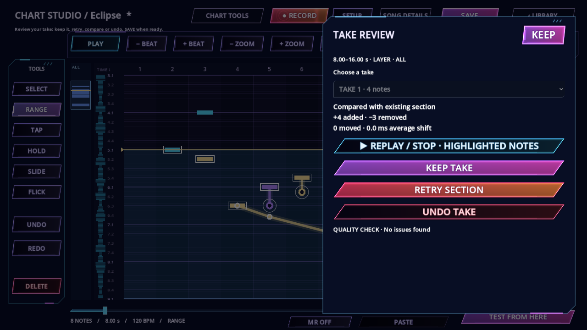

*Figure 14. The take is provisional while you inspect it. New notes are highlighted in gold.*

### Replay the phrase

Press **REPLAY / STOP · HIGHLIGHTED NOTES**. The review panel temporarily hides so the entire timeline is visible. The song plays through the recorded section, with the new notes highlighted.

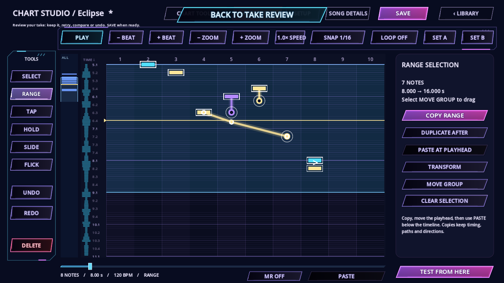

*Figure 15. BACK TO TAKE REVIEW stops the audition and restores the review panel.*

Playback returns to review when the section ends. It uses the editor's audition speed, which is separate from the recorder's speed setting.

### Decide what to keep

| Action | Result |
| --- | --- |
| **KEEP TAKE**, or the fixed top **KEEP** button | Accepts the provisional notes into your draft and closes review |
| **RETRY SECTION** | Restores the chart from before the provisional take and starts another attempt of the same section, retaining the completed take bank |
| **UNDO TAKE** | Restores the chart from before the provisional take and closes review |

If you see **EMPTY TAKE**, existing notes are kept unchanged. Check the punch boundaries, active pass, and type locks before trying again.

### Read quality flags

The quality check can flag:

- Notes overlapping in the same lane.
- Closely spaced notes that may be accidental double taps.
- Very short holds or slides.
- Extremely rapid slide movement.
- Invalid note data or notes extending beyond the song end.

Flags are review prompts, not automatic musical judgments. Intentional patterns can still trigger them. Review displays up to eight flags; use **CHART TOOLS → Validate** for the fuller list.

## 9. Repeat and combine takes

### Loop a difficult phrase

Enable **LOOP TAKES** in Setup. Each time the region ends, SYNK banks that attempt and starts another at the same region with the configured lead-in. A session holds up to **32 attempts**.

Press STOP when you have enough attempts. The **Choose a take** dropdown lists the completed attempts. Selecting one updates the provisional notes; it does not stack every attempt into the chart.

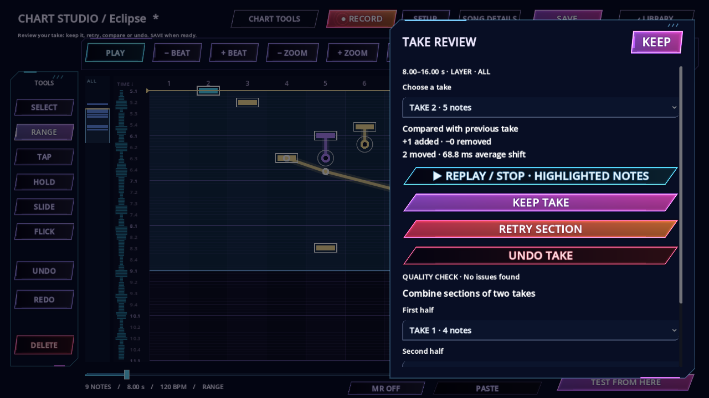

*Figure 16. Choose a take and inspect its differences before keeping it.*

Comparison reports added notes, removed notes, moved notes, and the average timing shift of matched moved notes. The first attempt is compared with the existing section; later attempts are compared with the preceding take. These figures describe differences, not a performance score.

### Splice the strongest parts of two attempts

With at least two takes, scroll down to **Combine sections of two takes**.

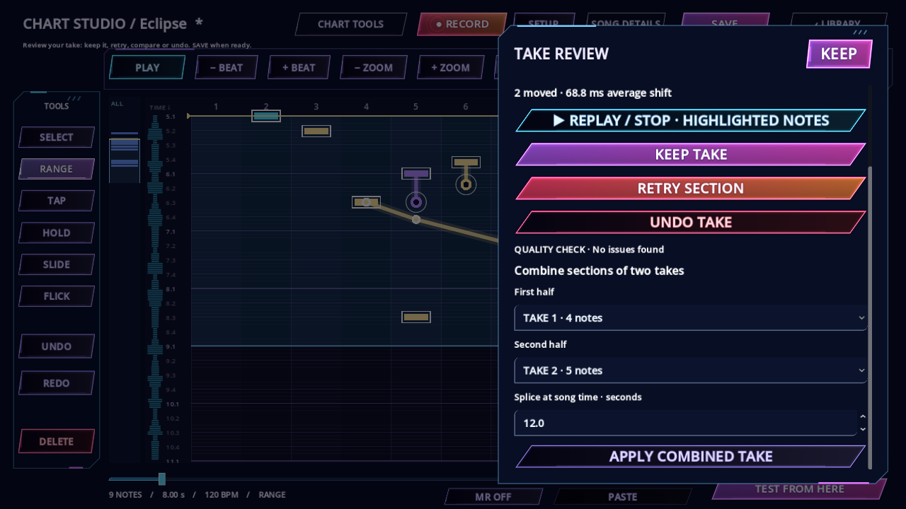

*Figure 17. The splice time determines which take supplies each part of the phrase.*

1. Choose the attempt supplying the **First half**.
2. Choose the attempt supplying the **Second half**.
3. Enter **Splice at song time — seconds**.
4. Press **APPLY COMBINED TAKE**.
5. Replay and inspect the combination, then choose **KEEP TAKE**.

For example, for an 8–16 second phrase, choosing Take 1, Take 2, and a splice at **12.000** uses Take 1's notes starting before 12 seconds and Take 2's notes starting at or after 12 seconds. A sustain from the first take crossing the splice is trimmed there. Check that the transition still feels natural.

**The take bank is temporary session data.** Starting a new session replaces it, and it is not a permanent library of recordings. Finish and save the chosen notes before leaving work you want to preserve.

## 10. Save, validate, and test the chart

### Save the accepted notes

After Keep Take, press **SAVE** at the top of Chart Studio. Confirm the status says **Chart saved**. The unsaved-change asterisk in the title clears.

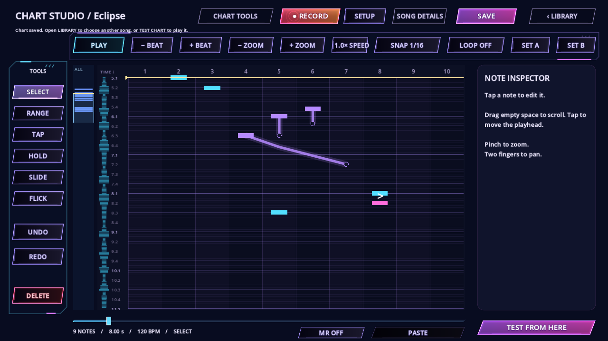

*Figure 18. SAVE publishes the current chart version's notes and timing settings.*

Autosave provides draft recovery, but saving is the explicit step that updates the published chart. Provisional notes are autosaved as draft notes; undoing or retrying a take updates that draft too.

### Validate the chart

Open **CHART TOOLS → THIS CHART → Validate** and press **RUN CHECK**. Inspect warnings, return to the editor to fix unwanted patterns, then save again.

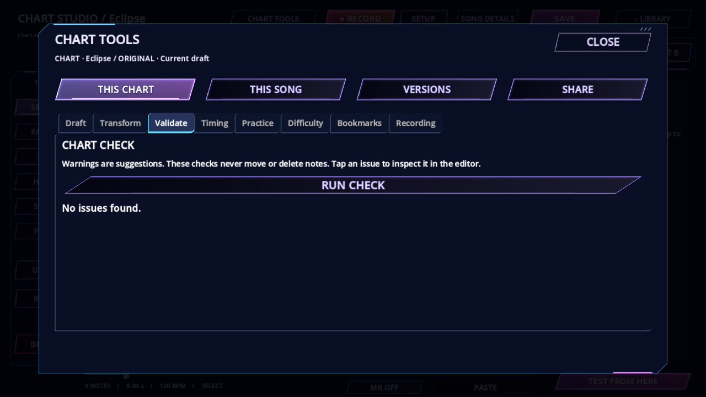

*Figure 19. Validate checks the current chart, including notes already present before recording.*

### Play-test it

Close Chart Tools, position the playhead near the phrase, and press **TEST FROM HERE**. Check whether the chart is comfortable to play, whether sustains release naturally, and whether flick directions match your intended gestures.

Repeat the cycle as needed: **record → review → correct → save → test**.

## Record in separate passes

For a layered arrangement, try this sequence:

| Pass | Setup | What to focus on |
| --- | --- | --- |
| 1 | Taps Only, Layer | Core rhythm and repeated beats |
| 2 | Holds Only, Layer, Lock Tap | Sustained accents and release timing |
| 3 | Slides Only, Layer, Lock Tap and Hold | Lane movement and phrase shape |
| 4 | Flicks Only, Layer, lock completed types | Clear directional accents |

Keep and save after a pass you want to preserve. Change the session setup, then start a new recording for the next pass. Remember that adding a layer can still produce unwanted overlaps; replay and validate the combined result.

For repairing only the tap rhythm, use a **Taps Only + Replace** session within a punch range. Existing holds, slides, flicks, and locked types remain protected from that replacement.

## Customize note visibility

Open the lobby gear, then **VISUAL EFFECTS**.

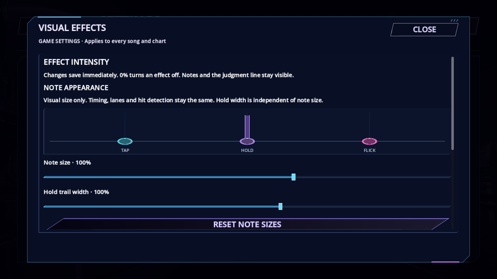

*Figure 20. Appearance controls are global and apply to recording visuals too.*

- **Note size:** 60–125%, affecting note heads and associated flick arrows/release rings.
- **Hold trail width:** 30–150%, independent of note-head size.
- **RESET NOTE SIZES:** returns both controls to 100%.

The preview updates while you adjust the sliders. Slide widths keep their existing value. These appearance changes do not alter chart timing, lane positions, or hit detection.

## Settings ownership and saving

| Level | Examples | Where they belong |
| --- | --- | --- |
| **Global preference** | Recording speed, MR preference, pre-roll bars, recording quantization/grid, guide subdivision/volume, ghosts, note size, hold width | Settings and recorder shortcuts; persists across charts |
| **Song** | Source audio, title, album, cover | Song Details; shared by its chart versions |
| **Chart version** | Notes, BPM, first-beat offset, section markers, bookmarks | Chart Studio/Chart Tools; saved with that version |
| **Recording session** | Punch bounds, Layer/Replace, Loop Takes, pass, locks, temporary take bank and splice choices | Recording Setup and Take Review |
| **Editor transport** | Playhead, selection, zoom, editor snap, audition speed, A–B | Editor controls |

Global recorder preferences are also accessible through **Settings → EDITOR PREFS → RECORDER PREFERENCES**. That view omits the session-only punch, replacement, pass, and lock controls.

## Troubleshooting

| Symptom | Check or action |
| --- | --- |
| No notes are recorded | Wait for countdown/pre-roll; touch the lower highway near the judgment bar; check that the song time is inside the punch region. |
| A selected tool is disabled | Check the session's recording pass and type locks. A focused pass limits the available tools. |
| A flick is missing | Select FLICK or Flicks Only and make a clear up/left/right swipe. AUTO does not infer flicks; downward flicks are unsupported. |
| A quick hold becomes a tap | AUTO uses a duration threshold. Choose HOLD explicitly for short sustained input, then inspect the result. |
| New notes duplicate existing ones | Layer keeps the existing notes. Use Replace for a repair pass, or remove unwanted duplicates and validate. |
| Pre-roll creates no notes | That is expected. Capture starts at the punch boundary. |
| The guide drifts through the song | Recheck the chart BPM. Check first-beat offset separately for a constant displacement. |
| Snap is consistently misaligned | Verify BPM and first-beat offset before changing the recording subdivision or quantization mode. |
| Recording is too fast | Cycle the recorder speed to 0.75× or 0.5×; source chart timing remains intact. |
| A correction disappears on stopping | Check whether the captured note was moved outside the session's punch region. |
| Setup changes did not affect the active take | Finish the session and start a new one. Existing loop attempts retain their original configuration. |
| Replay sounds faster than recording | Review uses editor audition speed, independently of recording speed. |
| A useful take is missing after starting again | A new recording session replaces the temporary bank. Keep and save useful notes before starting another session. |
| The chart is missing from normal playback | Keep the take, press SAVE, and check the intended chart version. Draft recovery is separate from published chart data. |
| Hold trails feel too broad | Reduce Hold Trail Width under Settings → Visual Effects. Note size is a separate slider. |

## Control reference and glossary

| Term or control | Meaning |
| --- | --- |
| **Playhead** | The current song time in the editor |
| **Punch-in region** | The bounded interval where a recording session accepts new notes |
| **Pre-roll** | Audible music before that interval starts |
| **Take** | One completed recording attempt |
| **Take bank** | The session's temporary collection of completed attempts |
| **Provisional take** | The attempt currently applied to the draft while review is open |
| **Layer** | Add new notes while keeping earlier notes |
| **Replace** | Replace eligible notes inside the recording region |
| **Pass** | A session focused on all note types or one chosen type |
| **Lock** | Protect a type from session replacement and correction |
| **Quantization** | Moving captured timing toward a musical grid |
| **Splice** | Joining the earlier part of one take with the later part of another |
| **Ghost notes** | Faded existing notes used as recording guides |
| **Draft** | Recoverable editing state, including accepted or provisional recorded notes |
| **SAVE** | Update the published chart version from the current editing state |

---

**Using this guide elsewhere:** keep `RECORDER_GUIDE.md` together with the `docs/recorder/images` folder, preserving that relative path. The accompanying ZIP contains both.
