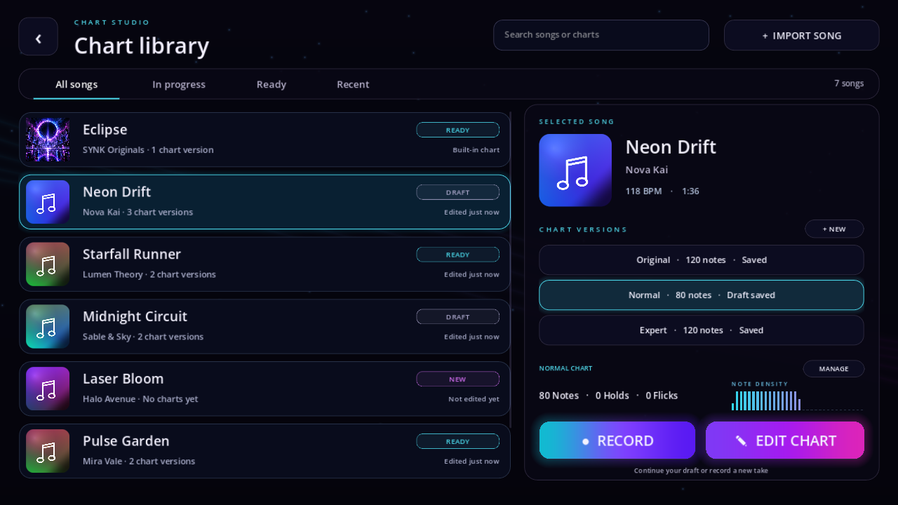

# Chart library redesign

The Chart Studio library follows the approved preview and the song selection/results visual style.

Screenshot uses isolated test data; the game displays the device's actual songs and charts.

## Flow

1. Open Create Charts from the lobby.
2. Select a song in the left list. Browsing keeps you in the library.
3. Select its chart version in the right panel. Draft notes take priority in the displayed statistics.
4. Choose **Edit Chart** to continue in the editor, or **Record** to record into that version. Existing notes remain as the recording baseline; draft recovery uses the existing authoring service.
5. Use **+ New** to open an unused Original/Easy/Normal/Hard/Expert version in the editor. Save it after adding notes.
6. Use **Import Song** to import audio through the existing picker.

## Ownership and status

- All songs, In progress, Ready and Recent filter the song list. Recent is real chart authoring history, separate from play history.
- Search covers song titles, artists and existing version names.
- In progress means a recoverable draft file or unsaved live edits. Ready means at least one saved chart, including the built-in Eclipse original; a song can qualify for both.
- Selected-version statistics count notes, hold/slide notes, flicks and actual note-head density over the song duration.
- Manage requires confirmation. Delete Chart removes only the selected version and its draft. Deleting Eclipse Original restores the built-in chart. Delete Song also removes that song's versions and drafts.
- No global game settings are placed in the chart panel.

## Verification

`godot_tests/test_chart_library_reference.gd` checks real version/draft counts, selection without navigation, artist search, empty states, filters, async launch and cancellation, draft recovery, recording preservation, new versions, version-scoped deletion, whole-song cleanup and compact layout.

Screen-polish integration checks the new library alongside the editor, recorder, settings and results. The new UI shares the existing song-browser background, rounded buttons, cover styling and touch scrolling.
