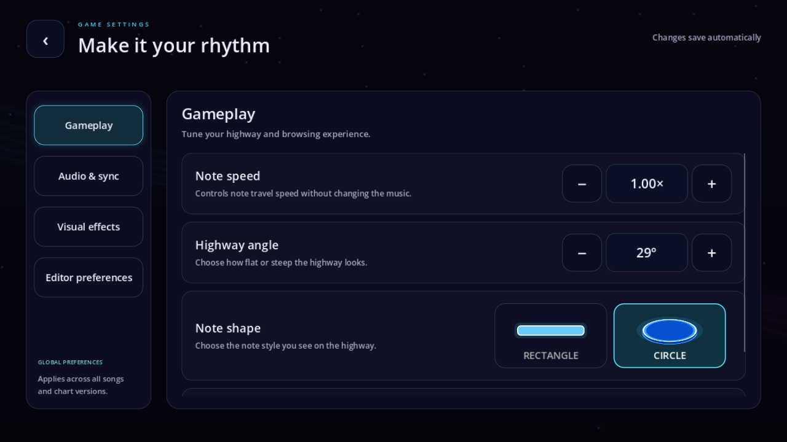
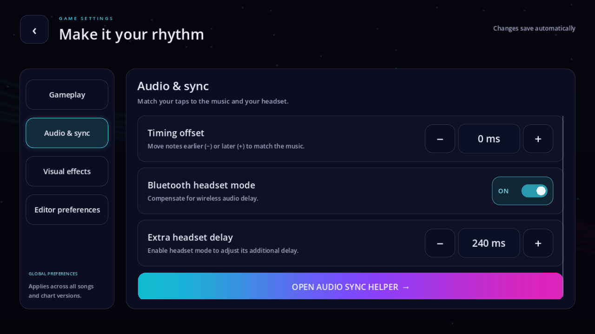
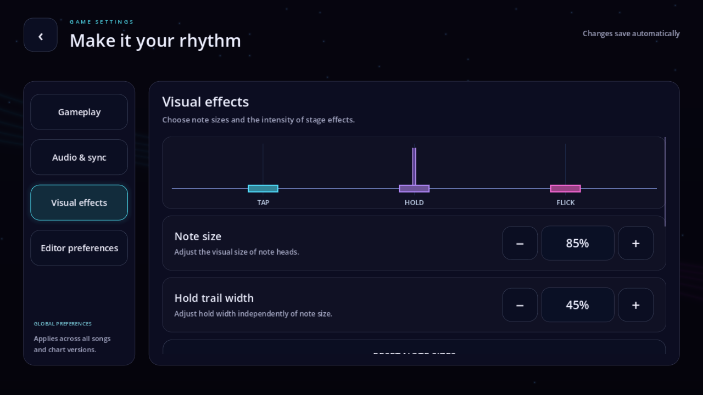
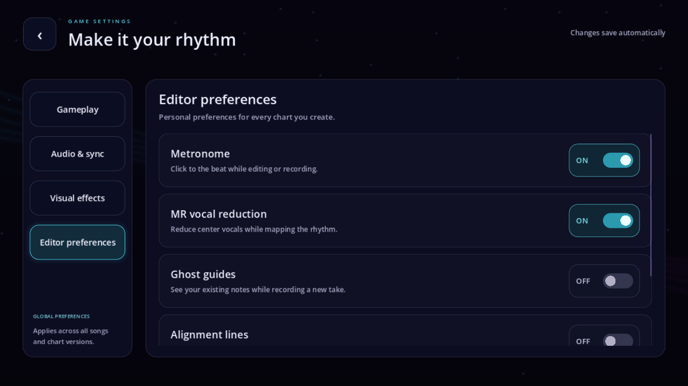

# Settings UI

Settings matches the rounded song selection, chart library and results panels. A category rail keeps navigation stable while each content page scrolls independently.

## Categories

- **Gameplay:** note travel speed, highway angle, note shape, song preview preference.
- **Audio & sync:** timing offset, Bluetooth compensation, extra headset delay and audio sync helper.
- **Visual effects:** live appearance preview, note size, shared hold/slide width, hit flashes, particles, lasers and background brightness; separate size/effect resets.
- **Editor preferences:** metronome, MR vocal reduction, ghost guides, alignment lines, recording speed and recorder preferences.

These settings are global personal preferences. Chart notes/timing/bookmarks, song metadata and temporary session controls stay in their existing scope. See [setting ownership](../SETTINGS_SCOPES.md).

## Interaction

Large 72-unit numeric controls and category buttons use rounded outlines, eased hover/focus lighting and touch feedback. Pill switches animate their thumbs and selected colors. Category changes slide and fade, including interrupted/rapid navigation. Screen entrances use existing screen transitions. Labels remain steady, with no idle pulsing.

Scroll containers use touch inertia. Dragging across a stepper, switch, action or shape tile cannot change the underlying setting. Returning from the audio calibration helper preserves the selected category. Opening Settings refreshes control values without emitting updates or rounding existing preferences.

## Verification

`godot_tests/test_settings_redesign.gd` checks exact-value preservation, stepper limits, shape selection, tab animation, Bluetooth dependency, calibration return, global visual/authoring controls, preference persistence, chart-data isolation, rapid navigation, drag cancellation, compact-screen fit and Back navigation.

Existing `test_tools_scope.gd` and `test_ui_motion.gd` regressions also pass. Screenshots of all four categories and a compact viewport are captured by the focused test.

