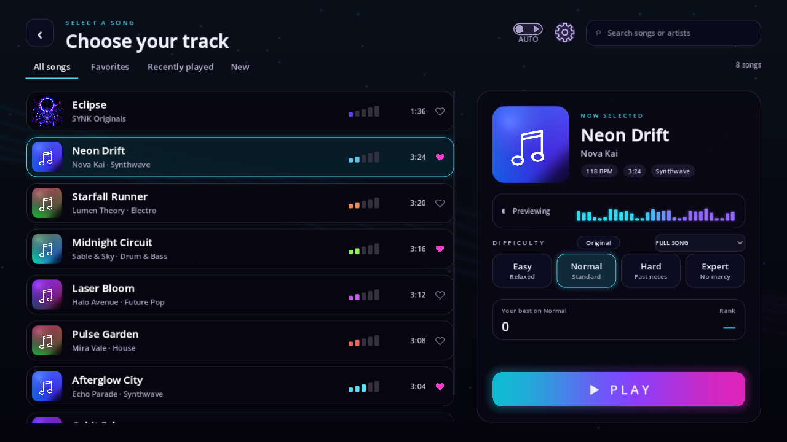
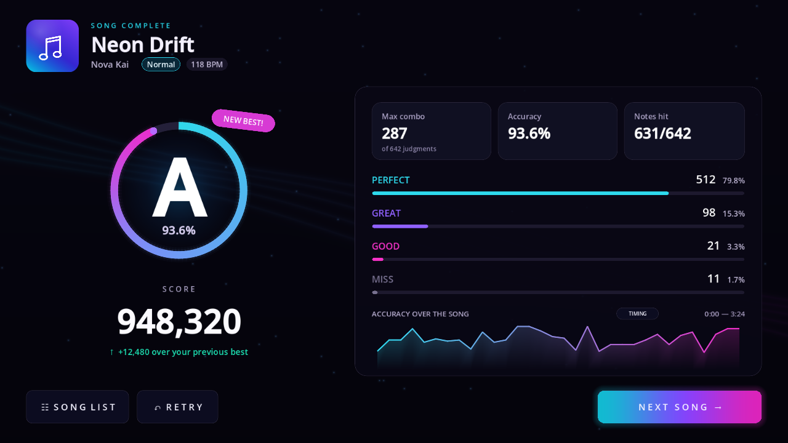

# Song selection and results redesign

Implemented from the user's supplied song-list and results-screen references on 17 October 2026.

## Song selection

- Compact vertical song rows with album thumbnails, song/artist metadata, duration, chart-intensity indicators and favorite hearts.
- All Songs, Favorites, Recently Played and New filters; search includes titles, artists and genres when available.
- A selected-song panel with square art, BPM/duration/genre chips, preview status/meter, difficulty cards, per-chart best score/rank and a cyan–purple–pink Play button.
- Easy, Normal, Hard and Expert load actual saved chart versions. Missing versions are disabled. Original remains available in a small supplementary control for existing charts; Hard was appended to the version list to preserve existing version indices.
- Section selection and the autoplay control remain available. Preview playback still uses the global Settings preference; the new screen has no separate preview toggle.
- Rows are reconciled and reused rather than recreated on metadata refresh. Vertical touch/mouse scrolling has momentum, stable pointer ownership and drag cancellation. Cover changes crossfade, and pending song loads never enable playback of the old song.
- New means unplayed imported songs, newest imports first. Recent history records real playback starts. Missing metadata is shown as unavailable instead of inventing artists, durations or charts.

## Results

- Song identity at the top; animated gradient rank ring, white rank, accuracy, score and best-score improvement at the left.
- Rounded summary cards for max combo, weighted accuracy and notes hit; judgment counts/percentages and animated bars at the right.
- Accuracy history is recorded from scored judgments, including checkpoints and sustain releases. The graph aggregates actual events into time windows, omits empty windows and fits its vertical range to the observed values; its tooltip explains that range. The timing drilldown is retained.
- Notes Hit counts successfully hit note heads rather than treating every checkpoint/release judgment as a separate note. Max-combo context is therefore labeled in judgments.
- Song List returns directly to selection. Retry preserves the run's chart and section; practice retries remain practice. Next Song skips unavailable/empty charts, waits for the requested audio/chart to load and cancels if the user chooses another song.
- Auto Play and practice remain explicitly unsaved, suppress New Best and preserve their distinct rank labels.

## Verification

`test_song_browser` covers reference layout, artist search, empty/favorite/recent/new states, chart selection and Hard version storage, per-chart score/rank, row reuse, touch gestures, missing charts and compact screens.

`test_reference_results` covers scoring telemetry, note/judgment separation, result totals, prior-best delta, real graph data, empty results, timing view, Auto Play/practice behavior, compact layout, direct Song List navigation, async Next Song loading and cancellation.

Additional checks: song-list async/transport regressions, animated gateway, chart-setting ownership, version/draft/sharing workflows, practice/timing, core and cross-screen layout. Desktop captures were inspected at 1280×720 and 1024×600. Screenshot fixtures are isolated from the user's chart library.

