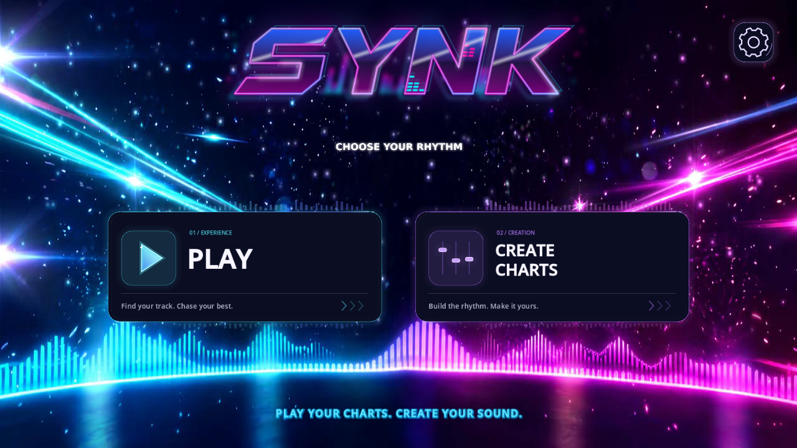

# Lobby button motion

## Current rounded theme

`scripts/art_button.gd` draws the active lobby controls as native vector shapes: dark rounded plates, thin cyan/violet rims, inset rounded icon tiles and a matching rounded Settings tile. Shapes and captions render at the viewport's scale without baking text into raster textures. The logo and reference/video backdrop are preserved. A separate live particle/light overlay adds subtle atmosphere, including when the fallback still is shown. Its clock stops when hidden.

The equalizers, two traveling rim lights, sequential chevrons, Play triangle glint, three chart faders and rotating gear remain animated. Hover/focus lifts the visual slightly; touch-down lights the rounded rim. Captions never pulse, and input rectangles/scale stay stable. Hidden buttons stop their clocks. Entrances are staggered.

`godot_tests/test_lobby_art_motion.gd` verifies clocks, focus, stable hit rectangles, hidden suspension, navigation and compact sizing. `test_mode_lobby.gd` covers integration with the song browser, chart library, Settings and recording entry.



## Archived supplied-art pipeline

The following generator describes the earlier angled artwork. Its assets remain available, but regenerating them does not replace the active rounded controls.


The original supplied SVGs remain in `svg/`. `render_motion_assets.py` derives animation layers from them using the same Chrome renderer as the original lobby pipeline. It renders with an isolated temporary Chrome profile.

The chassis, labels, badge and descriptions stay together. Extracted equalizers use the original rectangle coordinates; moving rim highlights follow the original polygon. Play has a separate triangle with a restrained glint. Create Charts has three independently moving faders. Chevrons animate in sequence. The settings gear rotates inside the stationary orb. Hover/focus increases light activity and lifts the visual chassis slightly; touch-down briefly discharges the rim. The button's input rectangle and scale stay unchanged.

Animations use delta time and stop while the gateway is hidden. A staggered entrance fades the logo/header/footer and brings in the buttons. The original transparent logo animation runs at 60 frames per second without pulsing or scale changes.

The gateway uses `assets/lobby/ui/reference_background.png`: a clean background plate edited from the supplied Gemini reference to remove its baked-in foreground UI. Removed regions were reconstructed; it is not a pixel-identical copy. The old flat procedural spotlight overlay is omitted so it cannot obscure the reference lighting. The entire plate remains visible across landscape aspect ratios, including both edge flares.

Regenerate derived assets from the repository root:

```powershell
python tools/lobby_ui/render_motion_assets.py
```

The generator also writes `scripts/lobby_art_geometry.gd`, so bar/rim data are available in exported APKs without relying on a loose JSON file.

Validation: `godot_tests/test_lobby_art_motion.gd` covers geometry, live clocks, touch/focus, stable hit rectangles, hidden animation suspension, all three navigation routes and compact sizing. Idle screenshots also confirm that label pixels remain stationary while decorative pixels change.
